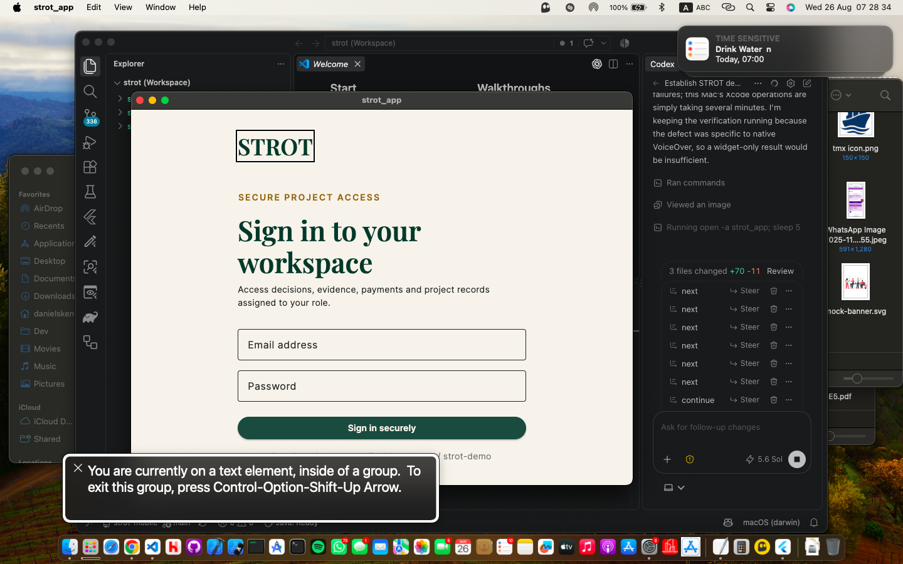
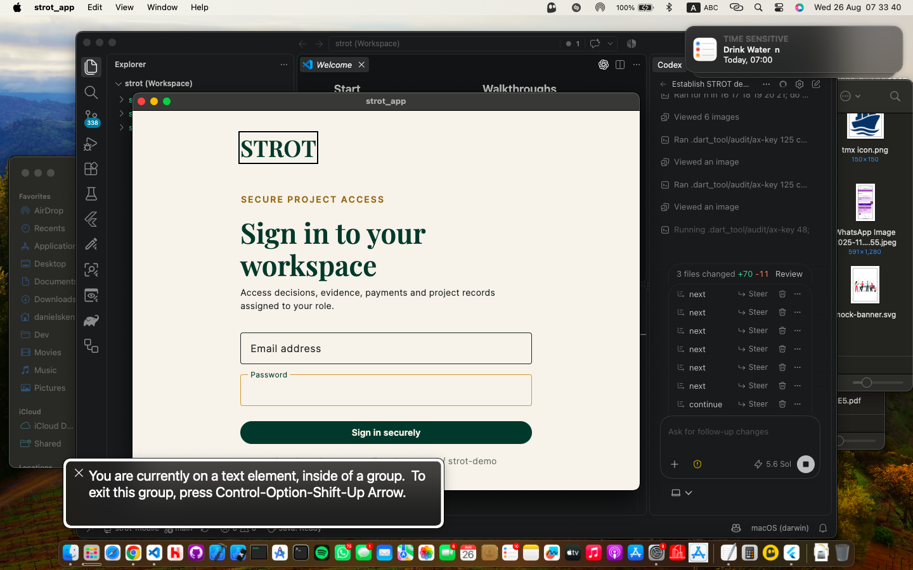

# Flutter native assistive-technology sweep

Date: 26 August 2026  
Scope: local macOS Flutter sign-in with VoiceOver; Android/TalkBack target discovery  
Environment: local debug build with explicit mock services

## Verdict

The macOS sign-in flow is keyboard operable and its corrected semantics tree exposes explicit Email address and Password labels. The live VoiceOver sweep found and corrected a field-label defect, but it does not close the full release-device gate: scripted VoiceOver navigation remained pinned to Flutter's outer accessibility group, and no Android device or emulator was connected for TalkBack.

VoiceOver was turned off and the local STROT debug process was closed after the audit.

## Accepted evidence

### 1. Native sign-in and VoiceOver entry — healthy

- VoiceOver starts on the STROT text element in the native Flutter window.
- macOS exposes the Flutter surface as an accessibility group.
- The caption panel and focus ring provide direct VoiceOver evidence rather than inferring behavior from a screenshot.

### 2. Email keyboard focus — corrected semantics, native cursor limitation

- Tab moves focus from the content group to Email address.
- The persistent field label remains visible while editing.
- A focused widget semantics assertion now confirms that the native-bound node contains `Email address`.

### 3. Password keyboard focus — corrected semantics, native cursor limitation

- Tab moves next to Password, followed by the submit action.
- The password value remains empty and obscured.
- A focused widget semantics assertion now confirms that the native-bound node contains `Password`.

## Flow health

1. Launch native STROT sign-in: healthy.
2. Start VoiceOver and enter the Flutter surface: healthy.
3. Traverse editorial content: partial; VoiceOver identifies the outer Flutter group but scripted right-arrow traversal can remain on its first text element.
4. Focus Email address: healthy after explicit semantics correction.
5. Focus Password: healthy after explicit semantics correction.
6. Focus Sign in securely: healthy keyboard order.
7. Android TalkBack sweep: blocked; no Android device, emulator or `adb` target is available.

## Defect corrected

Before correction, the native VoiceOver caption identified the focused password control only as `edit text`, omitting its purpose. Both sign-in fields are now wrapped in explicit text-field semantics with stable keys. The regression checks the actual focused semantics labels rather than only visible decoration text.

## Verification

- Focused Flutter widget/semantics test: pass.
- Focused Flutter analysis: pass with no issues.
- Native macOS debug build with mock services: pass.
- Native keyboard order: Email address → Password → Sign in securely.
- VoiceOver runtime and caption panel: exercised and captured.
- VoiceOver restored to off after testing.

## Remaining release-device work

- Repeat the broader authenticated workspace sweep with a human listening to VoiceOver announcements, including navigation changes, dialogs, validation errors and live regions.
- Run TalkBack on a connected Android release device or configured Android emulator.
- Confirm focus restoration after every modal, notification deep link and form submission on both platforms.

This audit does not claim complete VoiceOver, TalkBack, WCAG or platform accessibility conformance.

## Android emulator follow-up

A local follow-up found the installed Android SDK, `adb`, three existing AVD definitions and a Pixel 7 Pro API 34 system image. The existing Pixel AVD was started without changing its definition, recovered from `offline` to an `adb` device and reached Android's launcher after a boot timeout.

The STROT debug APK could not be accepted for testing on this run. Both the initial multi-ABI build and a narrowed `android-x64` build remained in Gradle assembly for more than twenty minutes under severe local CPU/memory pressure and produced no APK. Each build was stopped cleanly with exit code 130; no failed or stale APK was installed. The AVD was then shut down and `adb devices` returned empty.

Because STROT was never installed and no valid application screenshot or TalkBack announcement could be captured, this is recorded as a setup blocker rather than a TalkBack audit. The next attempt should run with sufficient free memory/CPU or use a connected Android release device, then capture the installed STROT flow before making any TalkBack claim.
