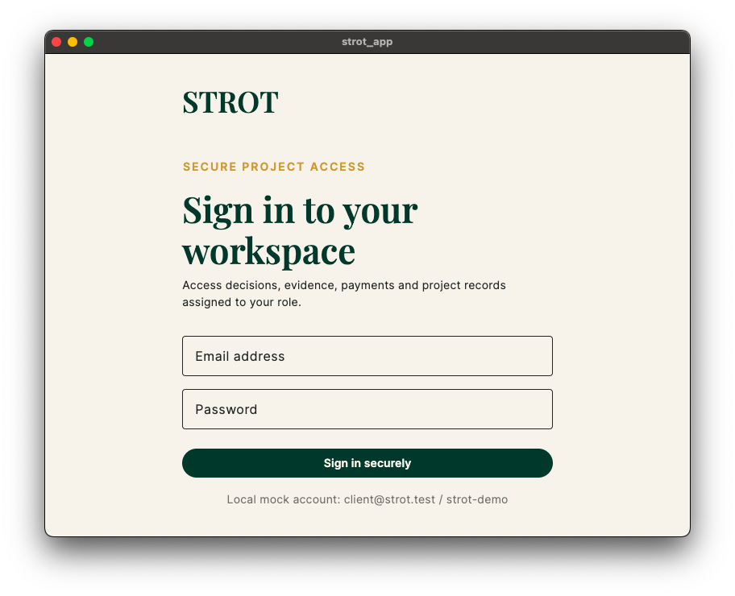
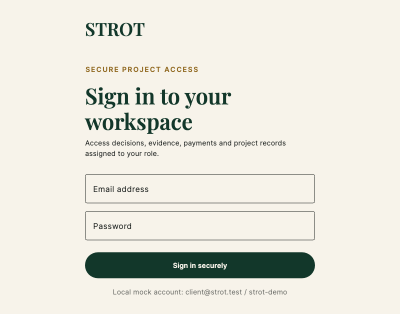
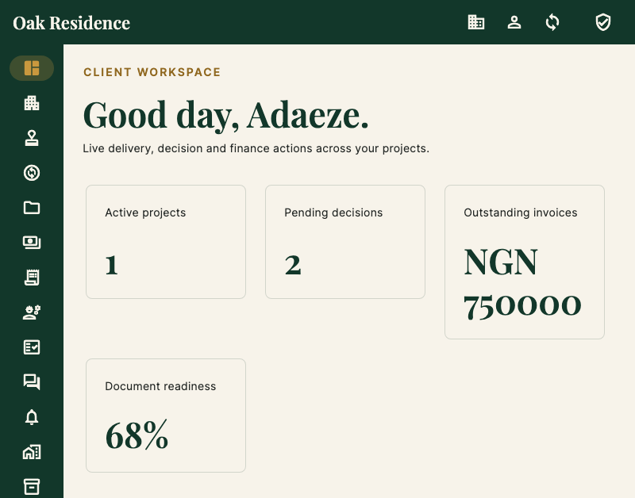
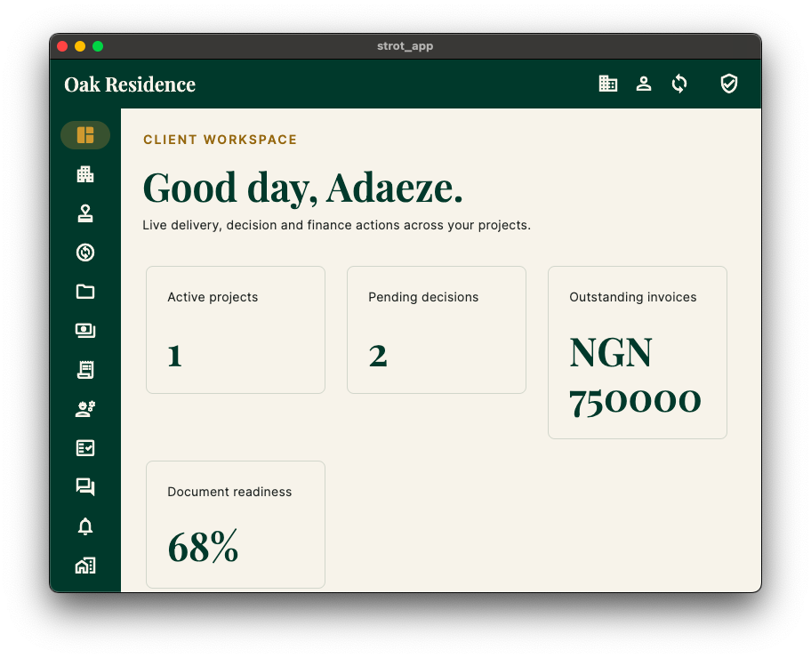
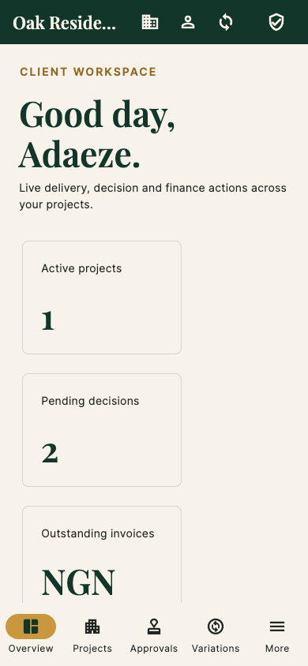
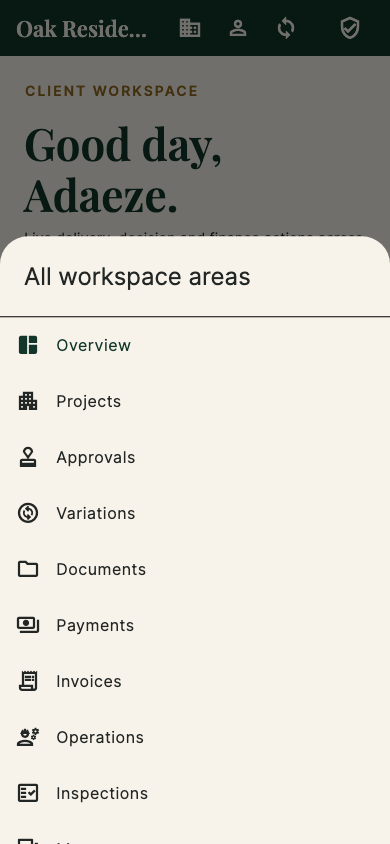
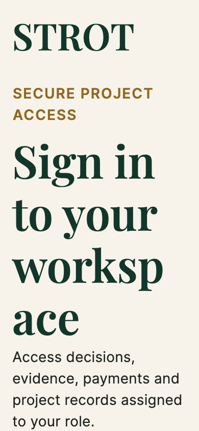

# Flutter authenticated visual and accessibility audit

Date: 26 August 2026  
Scope: local mock-authenticated macOS and phone-sized Flutter surfaces; sign-in, client overview, compact navigation, 200% text scaling and automated semantics guidelines.

## Verdict

The reviewed flow is healthy after two corrections made during the audit: gold foreground text on cream now uses an approved darker derived tone with sufficient contrast, and the Messages refresh/reply actions no longer return asynchronous work from `setState`. Sign-in, client overview and compact navigation render without overflow in the tested viewports. The 200% text-scale sign-in remains scrollable to its primary action.

## Accepted evidence

### 1. Native macOS sign-in — healthy

- Real local macOS window captured after Screen Recording access was enabled.
- Clear single-task hierarchy, persistent field labels, large primary action and correct bundled typography.
- The initial capture exposed insufficient gold-on-cream text contrast; the foreground token was corrected and verified by Flutter's WCAG contrast guideline.

### 1b. Post-fix desktop sign-in render — healthy

- Repeatable 800×628 render from the same Flutter screen after applying the accessible derived-gold foreground token.
- This is the visual baseline protected by the automated contrast, label and tap-target checks.

### 2. Desktop client overview — healthy with a navigation clarity watchpoint

- Delivery, decision, invoice and readiness measures have a clear reading order.
- The 800 px rail remains usable and independently scrollable.
- At this intermediate width the rail is icon-only. Flutter retains destination semantics, but unfamiliar icons may still be slower to interpret than the extended labels available at 1100 px and above.
- Native keyboard automation traversed email, password and submit in sequence, authenticated with the local mock account, and captured the resulting macOS workspace shown above.

### 3. Phone client overview — healthy

- Content reflows to a single column without horizontal overflow.
- Four primary destinations and the `More` entry remain visible in the bottom navigation.
- The organization name is deliberately truncated in the compact top bar, preserving the action controls.

### 4. Phone workspace menu — healthy

- Secondary destinations remain reachable in a named, scrollable sheet.
- The modal has a clear title, visible background separation and consistent icon/label pairs.

### 5. Phone sign-in at 200% text scaling — healthy through reflow and scrolling

- Editorial headings wrap instead of clipping or shrinking.
- The primary action moves below the initial viewport but remains reachable and hit-testable through the existing scroll container.
- No layout exception or overflow was produced.

## Automated accessibility evidence

- Flutter labeled-tap-target guideline: pass.
- Flutter Android minimum-tap-target guideline: pass.
- Flutter WCAG text-contrast guideline on sign-in: pass after the gold foreground correction.
- 200% text scale: primary sign-in action remains reachable and hit-testable.
- Accepted capture test and Messages regression test: pass.
- `flutter analyze`: no issues.

## Corrections completed

1. Added centralized `StrotColors.goldText` (`#906820`), a darker tonal derivative of STROT Gold, for gold foreground copy on cream surfaces. Base STROT Gold remains the accent on deep-green surfaces where it already has sufficient contrast.
2. Updated sign-in and client/partner workspace eyebrow copy to consume the accessible foreground token.
3. Corrected three Messages state refresh callbacks so `setState` performs synchronous assignment only.
4. Added repeatable screenshot, large-text, tap-target, label and contrast audit coverage.

## Evidence limits

- Screen Recording enabled a genuine native macOS sign-in capture; subsequent Accessibility access enabled native keyboard sign-in and an authenticated macOS capture. Exact phone and large-text evidence remains rendered from the same Flutter widgets and mock services at controlled device viewports.
- After Accessibility access was enabled, native System Events keyboard control successfully completed sign-in and captured the authenticated workspace. The Flutter macOS surface is nevertheless exposed to automation as a single accessibility group, and this environment cannot inspect or transcribe VoiceOver speech; automated semantics guidelines therefore reduce risk but do not replace a human-listened VoiceOver or TalkBack reading-order and announcement sweep.
- This focused audit does not claim full WCAG, macOS accessibility or mobile-platform conformance.
